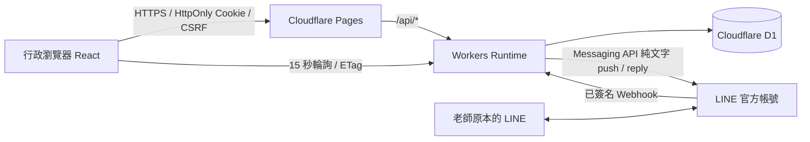

# Cloudflare 架構與資料設計

## 介面保留與資料流

原專案為 React 19＋Vite＋TypeScript，主畫面在 `src/main.tsx`，以狀態切換六個頁面；`RecordHistory`、原始 PNG Logo、暖黃配色及既有操作流程沿用。`src/api.ts` 保留展示模式，正式模式改呼叫同源 `/api`。沒有建立另一套前端。

Cloudflare Pages Advanced Mode 的 `_worker.js` 執行相同 Workers 程式，DB Binding 為 `DB`。`_routes.json` 僅讓 API 進入 Runtime，靜態成品由 Pages 提供。未引入額外即時服務、檔案儲存、訊息佇列或付費套件。

## 資料表

| 資料表 | 用途及保護 |
| --- | --- |
| admins | 唯一登入帳號、不回傳密碼雜湊；admin／staff、啟用狀態，觸發器阻止最後管理員被降級／停用 |
| sessions | 32-byte 隨機 Session 僅存 SHA256、CSRF 雜湊及回送 Token、8 小時絕對期限；每次請求連結啟用帳號 |
| teachers | 教師姓名、單位、備註、啟用、唯一 LINE User ID、綁定時間／事件時間、綁定版本、最後通知時間 |
| binding_codes | 每位教師一組目前有效碼，唯一 HMAC、7 天到期、使用時間、產碼操作人，不保存明碼 |
| rate_limits | 原子 UPSERT 計數與視窗到期；帳號／IP／LINE 身分以後端金鑰 HMAC 作為限流鍵 |
| templates | 四種可編輯通知範本 |
| send_requests | 發送請求識別碼、操作者及正規化內容指紋，避免相同識別碼被換內容重用 |
| notifications | 每教師／請求唯一、通知內容、綁定版本、固定 LINE retry key、傳送與業務狀態、完成時間／經辦 |
| messages | 教師、方向、文字、類型、事件／LINE 訊息唯一 ID、通知關聯、撤回與處理狀態；內部來源 HMAC 不回傳前端 |
| conversations | 每位教師的待回覆／已完成狀態 |
| webhook_events | 事件 ID 去重、原始來源身分、事件時間、處理／reply 結果；不保存原始本文、綁定碼或 reply token |
| unsend_tombstones | 撤回早於原訊息時保留來源／訊息對應，避免重送恢復已撤回文字 |
| handovers | 交接內容、手填交接人／完成人、實際操作帳號快照、完成時間及版本 |
| handover_revisions | 修改前後 JSON、原因、實際操作人及版本唯一約束 |
| internal_notes | 依教師保存辦公室內部備註，與對外訊息表分離 |
| audit_logs | 操作帳號、動作、時間、結果與關聯識別碼，不存密碼、碼明文或原始 LINE API 回應 |
| system_meta | 觸發器維護資料版本，供 ETag 輪詢省略未變快照 |

D1 是 SQLite，沒有瀏覽器直連或 PostgreSQL RLS。**唯一對外資料入口是 Workers**，所有參數化 SQL 執行前都有 Session／有效帳號／角色驗證；Webhook 入口獨立驗證 LINE 原始本文簽章。D1 Console／API 憑證本身是維護者權限，不可交給行政瀏覽器。

## Session 與權限

密碼先以獨立 `AUTH_PEPPER` 做 HMAC，再以每帳號隨機鹽進行 PBKDF2-SHA256／100,000 次。雜湊包含演算法版本／成本／鹽，支援後續遷移。Cloudflare 正式服務對單次 PBKDF2 有 100,000 次上限，本機 workerd 不一定實施此限制。此成本低於一般 OWASP 的 600,000 次建議，不宣稱保護程度相同；獨立 pepper、強密碼及限流仍必須保留。舊 600,000 次紀錄需由持有原始金鑰的維護者重新產生雜湊，不能只改紀錄中的次數。沒有前端硬編碼密碼，也沒有自助註冊或預設管理員密碼。

Session Cookie 在正式環境為 `__Host-office_session; Path=/; Secure; HttpOnly; SameSite=Lax`，本機 HTTP 才使用非 Secure 的 `office_session`。Session ID 不存 localStorage，不回傳 JSON；瀏覽器只持有 Cookie 和記憶體中的 CSRF Token。所有變更均須正確 Origin、JSON 格式及 CSRF；登入也須 Origin，且有登入失敗限制。僅設定單一允許來源，不使用 `*`。

一般行政能讀教師的可用資料並發送／回覆、更新狀態、處理交接與內部備註；不能新增教師／變更綁定／管理帳號或範本。操作紀錄僅管理員讀取；全員顯示名稱用來標示經辦人，行政人員不會取得其他人的登入帳號。停用／改密碼／改權限會刪除該帳號所有 Session，自己不得停用或降級自己。

## 原子綁定與 Webhook

Workers 先驗證原始位元組對應的 LINE HMAC-SHA256，再解析大小受限的 JSON。文字碼正規化為大寫並去除空格／連字號，以 `BINDING_PEPPER` 產生 HMAC；不把碼寫入事件或紀錄。

整包 Webhook 的 SQL 放進 D1 `batch()` 原子交易。每事件以事件 ID＋本次隨機 claim 判斷是否由本次新增，所有副作用都受此條件限制。綁定必須同時符合：教師啟用、尚未綁定、碼未用且未過期、事件不早於產碼、此 LINE 身分未綁其他人、身分及全域嘗試次數未超限。綁定、碼失效、稽核在同一交易內完成；唯一約束再阻擋並行重複綁定。

原始綁定事件不當作普通聊天保存。已綁帳號若再次傳送碼格式文字，記錄遮蔽提示，不保存碼明文。普通文字僅關聯當時綁定且事件時間不早於本次綁定的教師；已停用／未綁定身分不保存普通聊天正文。

訊息撤回以原訊息來源 HMAC 判斷，避免換綁後撤回到別人。若先收到撤回，先建立墓碑；後到訊息正文直接保存撤回提示。圖片等非文字只記錄類型與 Email 提示。群組／聊天室來源不參與教師私訊或綁定。

資料庫成功提交後才呼叫 reply API。reply 失敗不撤銷已完成的綁定，事件保存失敗標記；重送不重複回覆。一次最多 40 個自動 reply，優先綁定成功，保留其餘略過狀態以符合免費呼叫上限。D1 交易失敗回 500 讓 LINE 重送；若 LINE 超過重送期限仍未成功，不能保證日後取回未寫入的訊息。

## 通知與聊天

每批最多 100 位，用 JSON 參數一次建立個別通知。資料庫觸發器會檢查每位教師當下啟用且有相同綁定版本；任何一位不符合即全批回滾，不會送出部分錯誤對象。相同請求只能重用同一操作者／同一內容指紋。

原子 `UPDATE ... RETURNING` 只允許一個執行者把 queued 變成 sending；呼叫 LINE 前重查教師及綁定版本。HTTP 成功或 LINE 可辨認的 retry-key 409 記 accepted，4xx 記 failed，5xx／連線逾時記 uncertain。超過兩分鐘未完成的 sending 在讀取快照／下一次發送時轉 uncertain，不自動重送。只有 accepted 才新增對外聊天紀錄，並保留通知關聯與操作人。

解除綁定無法撤回已交給 LINE 的請求；操作人應停止該教師通知後再核對身分。任何網路系統皆無法將資料庫交易與外部 LINE API 變成同一個原子交易，因此不可宣稱「絕不重複」或「API 成功即教師收到」。

快照有最近筆數限制，資料持續保存在 D1；日期／教師／狀態篩選目前在已載入資料上執行。內部備註和交接流程不呼叫 LINE。交接使用版本比對及原子批次快照，舊版本操作回 409，不覆寫其他人的更正。

## API

| 方法與路徑 | 驗證／功能 |
| --- | --- |
| GET /api/health | 無敏感資訊的服務辨識 |
| POST /api/login | Origin、登入限流、密碼驗證，建立 Cookie |
| GET /api/session | Session，回傳目前帳號及 CSRF Token |
| POST /api/logout | Session＋CSRF，撤銷目前 Session |
| GET /api/data | Session，經權限過濾的快照；If-None-Match 支援 304 |
| POST /api/command | Session＋CSRF＋角色，`{action,payload}` 對應既有操作 |
| POST /api/line/webhook | LINE 原始本文簽章，免行政 Session；只有此路徑免 Origin／CSRF |

所有 API 錯誤為繁體中文 JSON；不輸出 SQL、參數、Token 或 LINE 原始錯誤。Schema 後續調整新增 Migration，不改寫已套用的正式 Migration。
